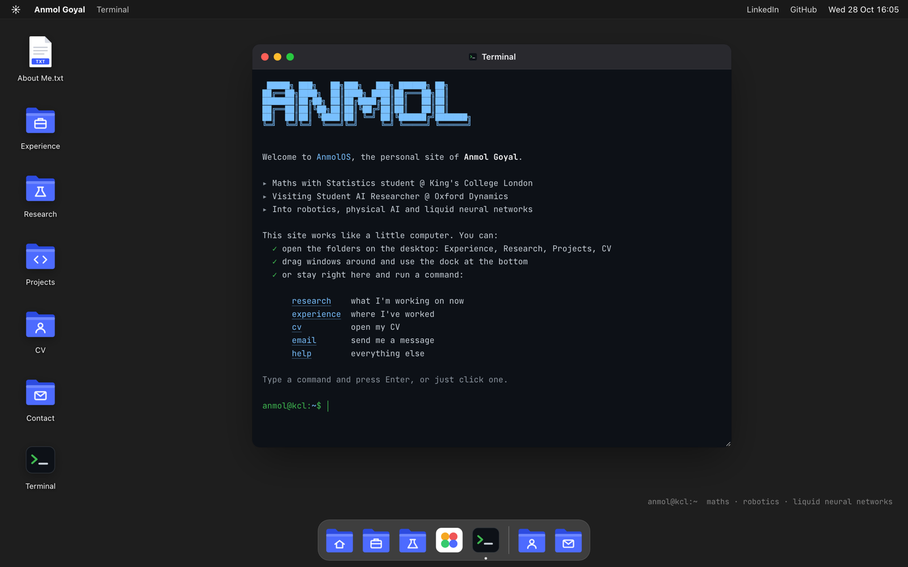

<div align="center">

# AnmolOS

**The personal site of Anmol Goyal, built as a tiny desktop operating system that runs in your browser.**

[](https://anmol-goyal.com)
[](https://pages.github.com)


[](https://claude.com/claude-code)

<a href="https://anmol-goyal.com">
  
</a>

</div>

---

## About

Instead of a scrolling page, the portfolio is a desktop. Folders on the left hold my experience, research, projects and CV. A dock sits at the bottom, and a terminal greets you when the site loads. You can drag windows around, open documents, flick through photos, read the CV or send me a message without leaving the page.

I'm a Maths with Statistics student at **King's College London** and a visiting student AI researcher at **Oxford Dynamics**. I work on robotics, physical AI and **liquid neural networks**.

## How this was built

I built this site with **[Claude Code](https://claude.com/claude-code)** as my pair programmer, and I'm upfront about that. Claude wrote most of the code. The product decisions, the design direction, the testing and the debugging that shaped it were mine. Here's what that looked like in practice.

**Product & design**
- **I set the concept.** The first version was a conventional scrolling portfolio. I didn't think it said anything about me, so I pointed at desktop-style sites I admired and changed direction to a browser "operating system".
- **I made the calls on what to cut.** An iteration with LaTeX equations and canvas diagrams looked worse in the browser than on paper, so I scrapped it rather than polishing it.
- **I designed the information architecture**: an *Experience* folder with *Oxford Dynamics* and *Leadership* inside, each with its own notes and a *Photos* folder, plus the desktop layout, wallpaper and dock.
- **I came up with the features that give it personality**: the terminal greeting you on load, a `reboot` command that plays a full shutdown and boot sequence, and a `cd` that actually navigates instead of just opening windows.

**Testing & debugging**

I tested every change in a real browser and on my phone. Most of the bugs fixed here are ones I found and reported:
- Project links that didn't open.
- Email buttons that did nothing on machines without a mail app. This led to building a real send-from-site contact form.
- The minimise button failing on maximised windows. The root cause was a CSS `display` rule overriding the `hidden` attribute.
- Contact messages taking over a minute to send. I pushed for a fix, which meant moving to a faster email provider and sending in the background with notifications.
- Stale versions after deploys, which led to cache-busting on every asset.

**Engineering & ops**
- Set up SSH deploys to GitHub Pages and the custom domain's DNS, including GitHub domain verification.
- Configured and verified the form-to-email services end to end with real messages.
- Asked the security question before anyone else did ("is this site secure?"). That led to a Content Security Policy, a referrer policy, input escaping, and a review of old endpoints left in the repo's history.

**Content & accuracy**

I reviewed every claim on the site and in the CV against what I actually did, and corrected what didn't match. An AI tool is only as trustworthy as the person checking its output.

> The way I see it: AI tools let one person move at the speed of a small team. What still matters is taste, judgement, and the persistence to test, find what's broken and insist it's fixed. That's the part of this project I'm proudest of.

## Features

| | |
|---|---|
| 🖥️ **Desktop and windows** | Drag, focus, minimise, maximise and close windows, like a real OS |
| 📁 **File system** | Nested folders with Markdown-style docs and photo galleries |
| ⌨️ **Terminal** | Opens on load with an ASCII welcome; real commands with a working `cd`, Tab completion, history and clickable shortcuts |
| 🦾 **Arm controller** | The robot-arm controller I wrote in my internship (ROS 2 + MoveIt), ported to the browser: `client.py` runs in its own terminal window and drives a real UR7e model in a WebGL viewer |
| ✉️ **Contact form** | Sends a message straight to my inbox in the background, with notifications for progress, success and failure |
| 📄 **CV viewer** | The PDF opens in a window, with buttons to open it in a new tab or download it |
| 📱 **Mobile layout** | On phones it becomes a home-screen grid with full-screen apps |
| 🔒 **Locked down** | Content Security Policy, no third-party scripts, all user input escaped |
| 🪶 **Zero dependencies** | Plain HTML, CSS and JavaScript, with no build step |

## What's on the desktop

```
~/
├── About Me.txt
├── Experience/
│   ├── Experience.md
│   ├── Oxford Dynamics/
│   │   ├── Oxford Dynamics.md
│   │   └── Photos/
│   └── Leadership/
│       ├── Leadership.md
│       └── Photos/
├── Research/
│   ├── Liquid Neural Networks.md
│   └── Reading List.txt
├── Projects/
│   ├── Arm Controller     (app: client.py in a terminal + the UR7e in a 3D viewer)
│   └── Arm Controller.md
├── CV/
│   └── Anmol_Goyal_CV.pdf
├── Contact/           → Contact.md, Email, LinkedIn, GitHub, Site Source
└── Terminal
```

## Terminal commands

```console
anmol@kcl:~$ help
```

| Command | What it does |
|---|---|
| `research` | Open my current research on liquid neural networks |
| `experience` | Open my experience |
| `cv` | Open my CV |
| `controller` | Launch my robot-arm controller |
| `email` | Write me a message |
| `contact` | Print my links |
| `cd <folder>`, `cd ..`, `cd ~` | Move around the file system (the prompt shows where you are) |
| `ls`, `pwd` | List the current folder (click an entry to go into it or open it), print the path |
| `cat <file>` | Read a document right in the terminal |
| `open <name>`, `open .` | Open a file or the current folder in a window |
| `about`, `whoami`, `photos` | Who I am |
| `reboot` | Shut everything down and boot again |
| `neofetch`, `date`, `echo`, `clear`, `exit` | The usual |

There are also a couple of easter eggs. Try `sudo`.

## Project structure

```
.
├── index.html               shell markup + <template> blocks holding each document's content
├── assets/
│   ├── css/style.css        windows, dock, terminal, notifications, light/dark + mobile layouts
│   ├── js/main.js           file system, window manager, terminal, contact form, boot screen
│   ├── js/arm.js            arm controller: client.py port, UR7e kinematics, IK + planners, WebGL viewer
│   ├── models/ur7e/         UR7e meshes converted from Universal Robots' ROS 2 description (BSD-3-Clause)
│   ├── img/                 wallpaper, Oxford Dynamics and event photos
│   └── cv/                  CV (PDF)
├── cv-src/                LaTeX source for the CV (build with latexmk, copy the PDF to assets/cv/)
├── favicon.ico
└── CNAME                    custom domain → anmol-goyal.com
```

## How it works

- **The file system** is the `FS` object at the top of `main.js`. Each entry is a `folder`, `doc`, `image`, `pdf`, `link`, `compose`, `photos` or `terminal`. A folder lists its children by id, and the window title path (e.g. *Experience / Oxford Dynamics / Photos*) is worked out from the tree.
- **Documents** live in `<template>` elements in `index.html`, so the content is plain HTML that's easy to edit.
- **The window manager** handles stacking order, dragging with pointer events, minimise to the dock and maximise. Windows open in a slight cascade so they don't stack exactly on top of each other.
- **The contact form** posts to [Web3Forms](https://web3forms.com) from the browser. The window closes as soon as you hit send, and a notification tracks the message. If sending fails, your draft is kept and you get a *Try again* button.
- **The arm controller** opens two windows. The terminal runs a line-by-line JavaScript port of my ROS 2 `client.py`, with the same commands, prompts, messages and error handling. A small planner stands in for `motion_server.py` and MoveIt: a damped least-squares IK solver, Cartesian paths in 5 mm steps, and joint-space moves. The viewer draws the real UR7e meshes with a hand-written WebGL renderer, posed with the kinematic chain from the official URDF (`base_link` frame). The meshes come from [Universal Robots' ROS 2 description](https://github.com/UniversalRobots/Universal_Robots_ROS2_Description) (BSD-3-Clause, licence in `assets/models/ur7e/`), converted to a compact binary.
- **Caching:** GitHub Pages caches pages for 10 minutes, so the CSS and JS are loaded with a `?v=N` query string. Bump `N` in `index.html` whenever they change.

### Adding something to the desktop

1. Add an entry to `FS` in `assets/js/main.js`:
   ```js
   talks: { name: "Talks.md", type: "doc", tpl: "doc-talks", w: 620, h: 560 },
   ```
2. Add its id to a folder's `children`, or to `home` to put it on the desktop.
3. For a doc, add the matching template to `index.html`:
   ```html
   <template id="doc-talks"> ... </template>
   ```

## Run it locally

```bash
git clone git@github.com:AG-droid/Ag-droid.github.io.git
cd Ag-droid.github.io
python3 -m http.server 8000
```

Then open <http://localhost:8000>. A local server is needed (instead of opening the file directly) so the CV preview and security policy behave the same as on the live site.

## Deployment

Every push to `master` is published by **GitHub Pages** to [anmol-goyal.com](https://anmol-goyal.com). The domain is set in `CNAME` and verified with GitHub, and HTTPS is enforced.

## Contact

<p>
  <a href="https://anmol-goyal.com">Website</a> ·
  <a href="mailto:anmol.goyal@kcl.ac.uk">anmol.goyal@kcl.ac.uk</a> ·
  <a href="https://www.linkedin.com/in/anmolxgoyal/">LinkedIn</a> ·
  <a href="https://github.com/AG-droid">GitHub</a>
</p>

<sub>© Anmol Goyal. The code is free to learn from; please don't reuse my personal content, photos or CV.</sub>
